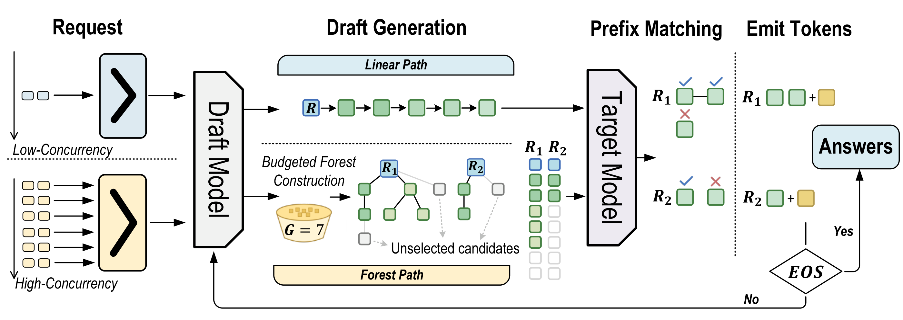
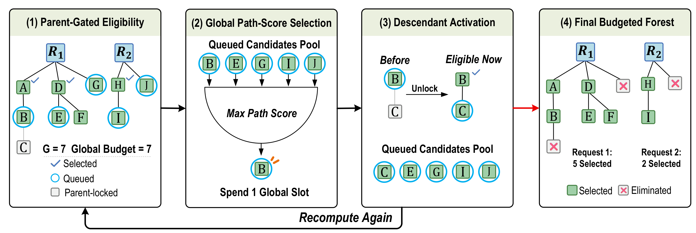
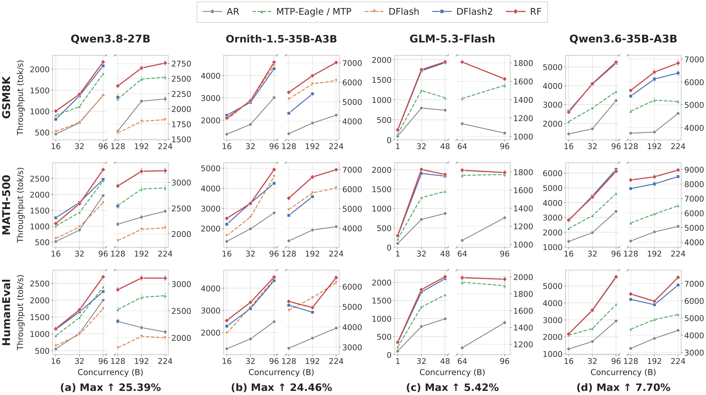

<div align="center">

<h1>🌲 Request Forest</h1>

<p><strong>Jointly Growing Verification Trees for Speculative Decoding</strong></p>

<p>Share the verification budget. Grow the useful branches. Serve more requests.</p>

<p>
  <a href="docs/INSTALL.md"></a>
  <a href="#quick-start"></a>
  <a href="#quick-start"></a>
  <a href="#benchmarks"></a>
</p>

<p>
  <a href="#overview">Overview</a> ·
  <a href="#how-it-works">Method</a> ·
  <a href="#results">Results</a> ·
  <a href="#quick-start">Quick start</a> ·
  <a href="#benchmarks">Benchmarks</a>
</p>

<sub>Anonymous research artifact</sub>

</div>

## Overview

**Request Forest (RF)** is a speculative decoding method for language models with recurrent state layers. It reuses a pretrained DFlash2 drafter and jointly selects candidate branches across requests under a shared verification budget. The target model verifies the resulting forest and commits the accepted path for each request. **No drafter retraining is required.**

<p align="center">
  <a href="assets/readme/overview.pdf">
    
  </a>
</p>

<p align="center"><sub>One drafter, two execution paths: native linear verification at low concurrency and a shared-budget forest at high concurrency. <a href="assets/readme/overview.pdf">View PDF ↗</a></sub></p>

| Shared budget | Compact verification | Adaptive execution |
| :--- | :--- | :--- |
| Allocate candidate nodes across requests, depths, and branches. | Allocate temporary verification state to selected nodes and commit accepted paths. | Choose the linear or forest path according to the active request count. |

## How it works

RF builds a **prefix-closed forest**: a candidate becomes eligible only after its parent has been retained. Eligible nodes compete across requests using the drafter's existing path scores. Selecting a node consumes one budget slot and exposes its children; selection continues until the budget or eligible candidates are exhausted.

<p align="center">
  <a href="assets/readme/forest-construction.pdf">
    
  </a>
</p>

## Results

The paper evaluates serving throughput, draft-token utilization, and verification-state memory on **GSM8K, MATH-500, HumanEval, and MT-Bench**. The figure below shows the main throughput results across four target models and three benchmarks.

<p align="center">
  <a href="assets/readme/throughput.pdf">
    
  </a>
</p>

Each subplot uses separate y-scales on either side of the axis break. **Max** is RF's largest gain over DFlash2 among the shared points shown in that model's column; AR denotes target-only decoding.

## Quick start

Start with the **[installation guide](docs/INSTALL.md)**. The shared runtime and all three model profiles are in this repository root.

| Component | Recorded environment |
| :--- | :--- |
| Platform | Linux x86-64 |
| Python | CPython 3.12 |
| PyTorch / CUDA | PyTorch 2.13.0 + CUDA 13 |
| GPU | NVIDIA SM120, as used on RTX 6000D |
| Execution | Four GPUs, tensor parallelism 4 |

This source release includes the RF CPU/CUDA operator sources and build entry points. Build the libraries for your machine; precompiled libraries are not included.

From the repository root:

```bash
python -m pip install -e .
python scripts/request_forest/load_native_cpu_ops.py --build-directory build/native
python scripts/request_forest/load_native_cuda_ops.py --build-directory build/native
```

Launch with a local target model and its matching DFlash2 draft checkpoint:

```bash
python launch.py \
  --profile qwen3.6 \
  --model-path /path/to/qwen36-target \
  --draft-model-path /path/to/qwen36-draft-bf16 \
  --gpus 0,1,2,3 \
  --native-dir build/native
```

The other profiles are `qwen3.8` and `ornith`. The default endpoint is `http://127.0.0.1:31721`. Add `--dry-run` to inspect the command without loading models, or use `--host` and `--port` to choose another endpoint. The [installation guide](docs/INSTALL.md#optional-flashinfer-preparation) also describes the optional FlashInfer planning optimization used in the measured setup.

## Benchmarks

The original serving evaluation uses **GSM8K · MATH-500 · HumanEval · MT-Bench** at the following concurrency levels:

```text
64  80  96  112  128  144  160  176  192  224  240  256
```

Each sweep runs **48 measurements** with a static memory fraction of **0.8**. The historical runner records throughput, latency, MAT, draft acceptance, raw generations, and the effective configuration. It measures serving performance; it does not grade answers or execute generated code.

The historical benchmark runner and its data downloader were excluded from the retained source archive and are not included in this repository. The original protocol is preserved in the [historical package guide](docs/ORIGINAL_PACKAGE_README.md#four-benchmark-sweep); its runner commands refer to the original distribution.

## Repository guide

| Directory | Purpose |
| :--- | :--- |
| **[docs/INSTALL.md](docs/INSTALL.md)** | **Recommended entry:** installation, native builds, and model launch instructions. |
| [`python/sglang/`](python/sglang/) | Shared serving runtime and RF implementation. |
| [`configs/`](configs/) | Common settings and Qwen3.6, Qwen3.8, and Ornith profiles. |
| [`scripts/request_forest/`](scripts/request_forest/) | RF CPU/CUDA build entry points. |
| [`benchmark/request_forest/`](benchmark/request_forest/) | Native operator registration sources. |
| [`assets/readme/`](assets/readme/) | Figures from the paper, with high-resolution PNG and vector PDF versions. |

## Acknowledgments and licenses

Request Forest builds on [SGLang](https://github.com/sgl-project/sglang) and reuses pretrained DFlash2 draft models. Upstream licenses and attributions are preserved. See the [license](LICENSE), [source notices](licenses/release/SOURCE_NOTICES.txt), and [third-party notices](licenses/release/THIRDPARTYNOTICES.txt).
